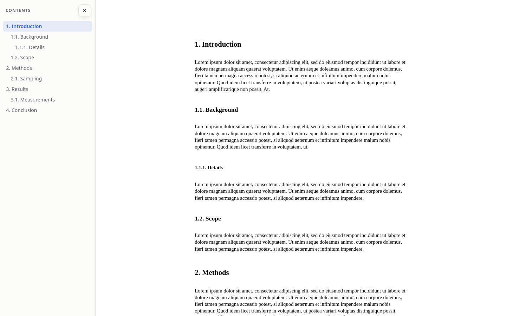
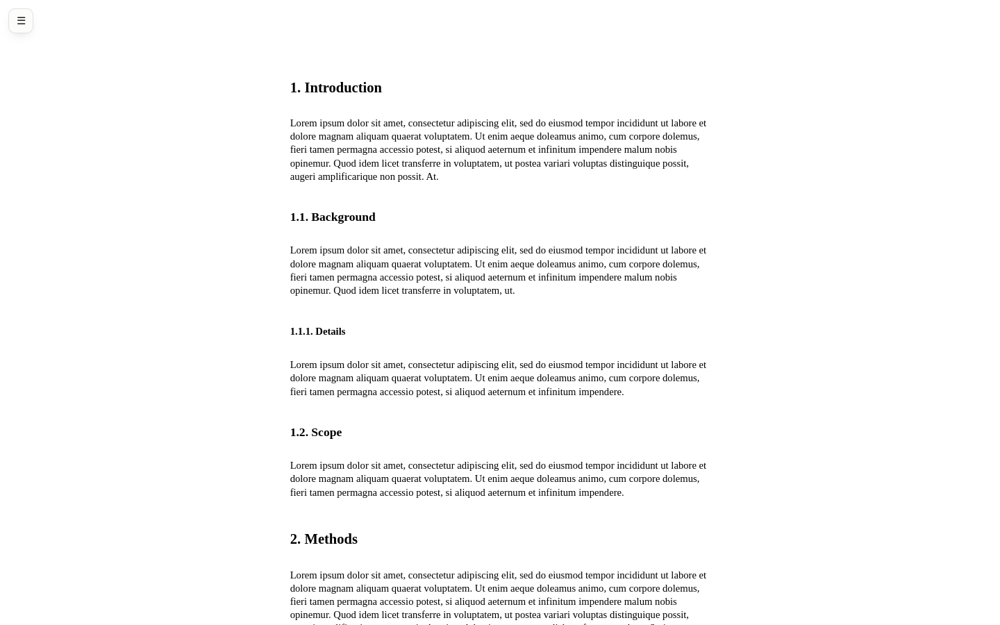
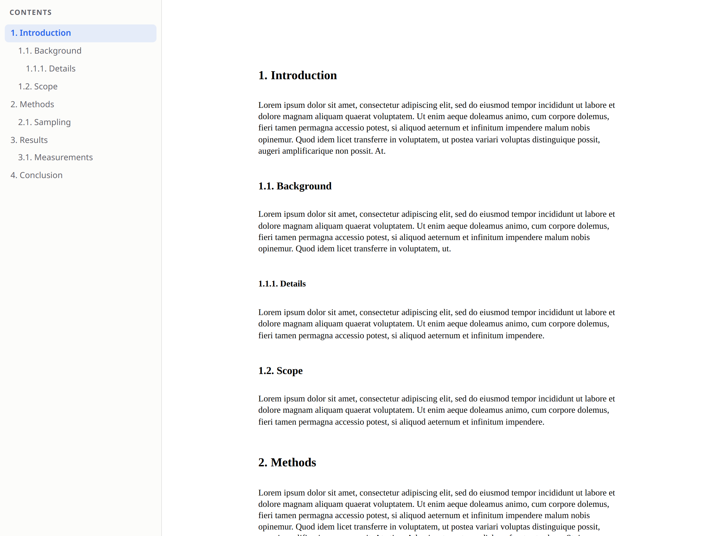
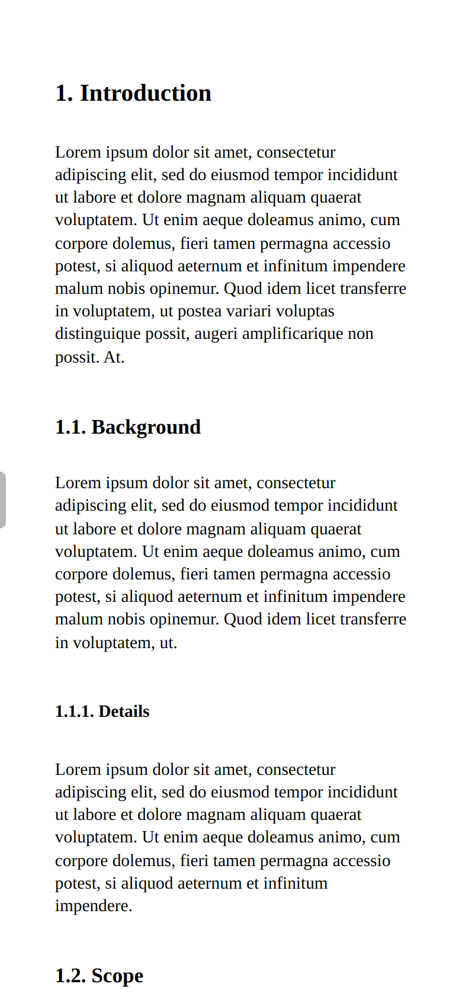
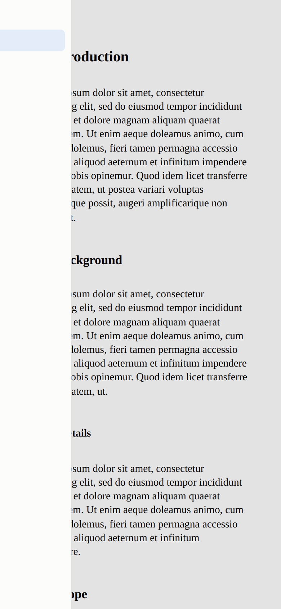
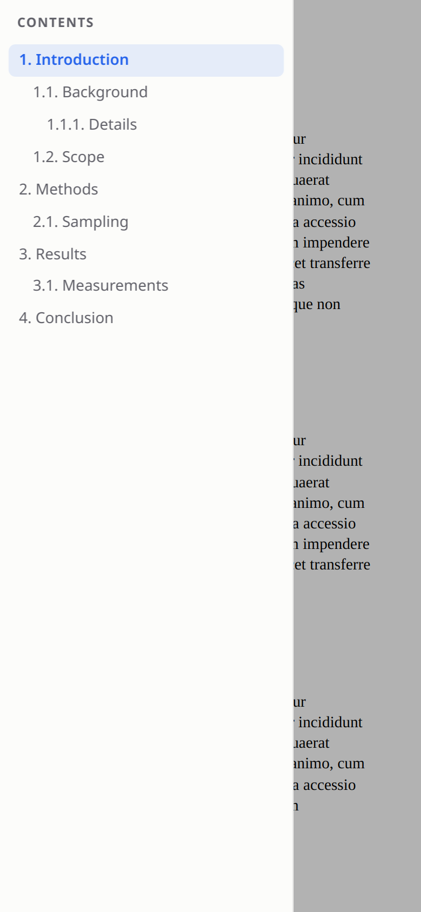

# Sidebar tests

Browser tests for the HTML table-of-contents sidebar in the package at the
repository root. They compile small Typst fixtures, serve the generated HTML,
and drive Chromium with Playwright.

## Requirements

- Typst 0.15 or newer (`typst --version`)
- Node.js 20 or newer
- Chromium for Playwright

## Run

```sh
cd test
npm install
npx playwright install chromium   # first run only
npm test
```

If `typst` is not on your `PATH`, point the tests at it:

```sh
TYPST=/path/to/typst npm test
```

The tests compile fixtures into `test/.output/` (ignored) and overwrite the
screenshots in `test/screenshots/`. Those screenshots are kept in the repository
so the rendered states can be inspected without running the suite.

## What is covered

`sidebar.test.mjs` runs 14 checks:

- **Renaming and version.** The root `typst.toml` is `mytemplate` 0.3.0 and no
  package source file still mentions the old package name.
- **Desktop, wide screen.** The sidebar is open by default, reserves space in the
  page, lists all heading levels in order, links to real heading ids, and exposes
  accessible labels.
- **Desktop, interactions.** The close button collapses it, the opener restores
  it, `Escape` closes it, and the page padding follows the state.
- **Desktop, outline navigation.** Clicking an outline link scrolls to the
  heading, and the scroll-spy marks the section at the end of the document.
- **Desktop, print.** Print styles hide the sidebar and remove the page padding.
- **Responsive default.** Resizing across the 64rem breakpoint opens or closes
  the sidebar when the reader has not chosen a state.
- **`toc: false`.** The nav, its CSS variable, and its inline script disappear.
- **Custom title.** `toc: (title: "目录")` changes the visible and accessible name.
- **Paged output.** SVG output is byte-identical with the sidebar enabled and
  disabled, so print output is unaffected.
- **Touch tablet.** A wide touch screen opens by default with no buttons and
  closes again with a left swipe.
- **Mobile, initial state.** The sidebar starts closed and off screen, with the
  open/close buttons hidden and the swipe hint visible.
- **Mobile, swipe open.** Progress, translation, and backdrop opacity follow the
  finger, then snap open on release. A screenshot is taken mid-drag.
- **Mobile, swipe close and snap.** Swiping left follows the finger, a short drag
  snaps back closed, and a long drag snaps open.
- **Mobile, dismissal.** Tapping the backdrop or an outline link closes the
  panel, while a vertical swipe never opens it.

Screenshots: `desktop-open.png`, `desktop-closed.png`,
`desktop-custom-title.png`, `tablet-open.png`, `mobile-closed.png`,
`mobile-drag.png`, and `mobile-open.png`.

## Screenshots

| Desktop open | Desktop closed |
| --- | --- |
|  |  |

| Tablet open |
| --- |
|  |

| Mobile closed | Mobile mid-drag | Mobile open |
| --- | --- | --- |
|  |  |  |

The mid-drag screenshot is taken at roughly one third of the swipe, so the
live finger-following state is visible.

## Files

- `fixtures/sidebar.typ` — nested headings and enough text to scroll.
- `fixtures/sidebar-off.typ` — the same feature with `toc: false`.
- `fixtures/sidebar-custom-title.typ` — a localized sidebar title.
- `fixtures/print-*.typ` — identical content used for the paged-output check.
- `helpers.mjs` — Typst compilation, static server, CDP touch gestures, and
  browser-state helpers.
- `sidebar.test.mjs` — the test cases.
